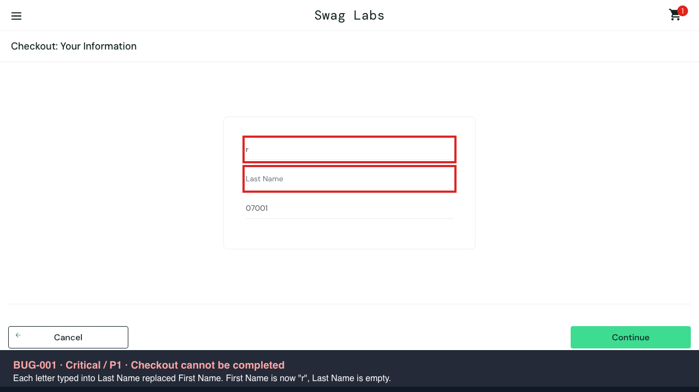
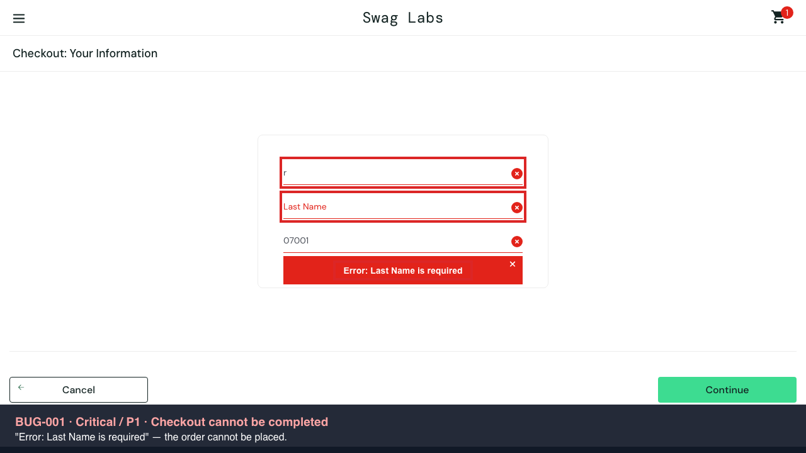
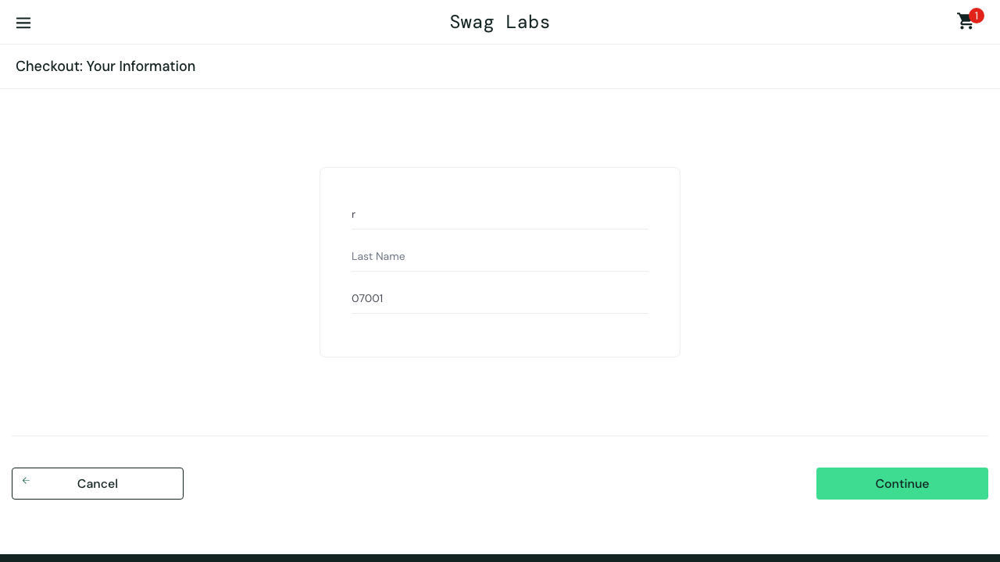

# BUG-001 — Checkout: typing a Last Name overwrites First Name, so checkout cannot be completed

| Field | Value |
|---|---|
| Severity | **Critical** |
| Priority | **P1 – fix this sprint** |
| Component | Checkout › Your Information |
| Labels | checkout, form, blocker, regression |
| Environment | https://www.saucedemo.com · Chromium 159 (Playwright 1.65.1, Desktop Chrome 1280×720) · macOS 26.2 |
| Account | `problem_user` / `secret_sauce` (control: `standard_user` behaves correctly) |
| Reported | 2026-11-16 · Anne Mary Wynter |
| Status | Open |

## Summary
On *Checkout: Your Information*, text typed into **Last Name** is written into **First Name** instead, and Last Name stays empty. Clicking Continue fails validation with *"Error: Last Name is required"*. The user cannot place an order.

## Steps to reproduce
1. Log in as `problem_user`.
2. Add *Sauce Labs Backpack* to the cart and open the cart.
3. Click **Checkout**.
4. Type `Anne` in First Name, `Wynter` in Last Name, `07001` in Zip/Postal Code.
5. Click **Continue**.

## Expected
First Name = `Anne`, Last Name = `Wynter`; Continue opens *Checkout: Overview* (`/checkout-step-two.html`).

## Actual
Each letter typed into Last Name replaces the whole First Name, so typing `Wynter` leaves First Name = `r` (the last letter) and Last Name empty. Continue stays on step one with *"Error: Last Name is required"*.

If the Last Name is pasted instead of typed, First Name becomes `Wynter`. Either way the first name is lost and Last Name stays empty. The walkthrough video shows the key-by-key case (`npm run walkthrough`).

## Impact
Blocks the purchase funnel for every affected user — no order can be placed. Hence Critical / P1.

## Evidence
Annotated screenshots (red outline = the defect):

Screenshot captured by the automated test:

- Screenshot after typing: [checkout-form-after-typing.png](evidence/BUG-001/checkout-form-after-typing.png)
- Video: [video.webm](evidence/BUG-001/video.webm) · Trace: [trace.zip](evidence/BUG-001/trace.zip) (`npx playwright show-trace bugs/evidence/BUG-001/trace.zip`)
- Assertion output: [assertion-failures.txt](evidence/BUG-001/assertion-failures.txt) — `Expected: "Anne"`, `Received: "r"`

## Automated test
`tests/problem-user/known-defects.spec.ts` › *BUG-001 checkout keeps the Last Name that was typed* (`@BUG-001 @sev-critical @P1`)
