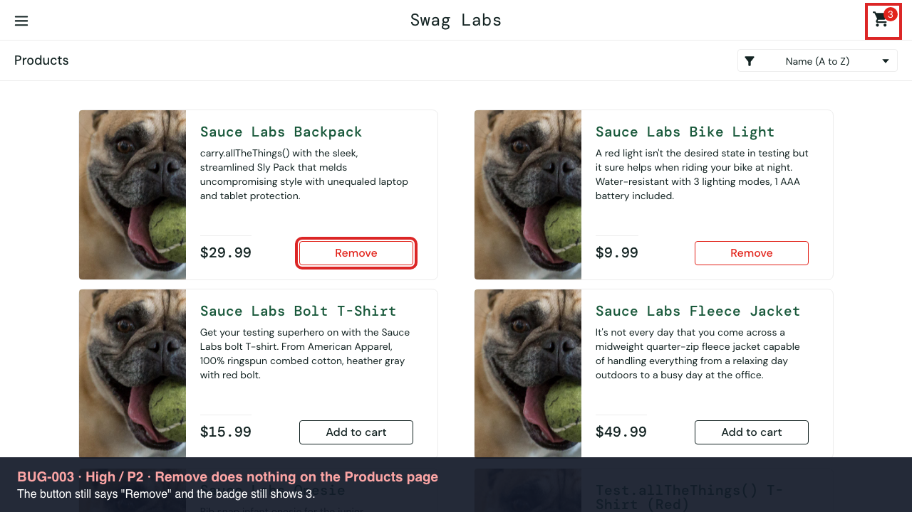
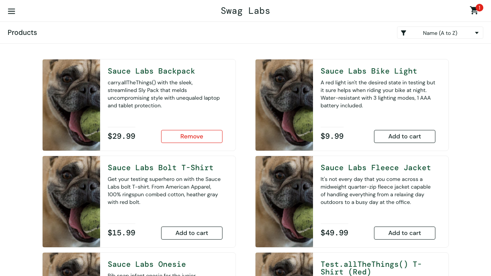

# BUG-003 — Remove button on the Products page does not remove the item

| Field | Value |
|---|---|
| Severity | **High** |
| Priority | **P2 – next sprint** |
| Component | Inventory › Remove from cart |
| Labels | cart, inventory |
| Environment | https://www.saucedemo.com · Chromium 159 (Playwright 1.65.1, Desktop Chrome 1280×720) · macOS 26.2 |
| Account | `problem_user` / `secret_sauce` (control: `standard_user` behaves correctly) |
| Reported | 2026-11-16 · Anne Mary Wynter |
| Status | Open |

## Summary
After adding a product, clicking its **Remove** button on the Products page does nothing: the button stays *Remove* and the cart badge keeps its count.

## Steps to reproduce
1. Log in as `problem_user`.
2. Click **Add to cart** on *Sauce Labs Backpack* — badge shows 1.
3. Click **Remove** on the same product.

## Expected
Button returns to **Add to cart**; cart badge disappears.

## Actual
Button still reads **Remove**; badge still shows **1**.

## Reproducibility
**Always (100%).** Confirmed 2026-11-16:
- Automated test, 10 consecutive runs: failed 10/10, same assertion each time.
- Scripted check, 5 fresh logins × 3 products (Backpack, Bike Light, Onesie): not removed 15/15. Same steps as `standard_user`: removed 15/15.
- The three products that cannot be added at all (BUG-002) cannot be tested here.

## Workaround
Removing the item from the **Cart page** works: 5/5 fresh logins, covered by the test *BUG-003 workaround: Remove works from the Cart page* (`@workaround`).

## Impact
Items cannot be removed from the Products page; they can still be removed from the Cart page. P2, confirmed in triage: only the checkout defect (BUG-001) is P1, and the Cart page workaround works.

## Evidence
Annotated screenshot (red outline = the defect):

Screenshot captured by the automated test:

- Screenshot after clicking Remove: [inventory-after-remove-click.png](evidence/BUG-003/inventory-after-remove-click.png)
- Video: [video.webm](evidence/BUG-003/video.webm) · Trace: [trace.zip](evidence/BUG-003/trace.zip)
- Assertion output: [assertion-failures.txt](evidence/BUG-003/assertion-failures.txt)

## Automated test
`tests/problem-user/known-defects.spec.ts` › *BUG-003 an added product can be removed from the inventory page* (`@BUG-003 @sev-high @P2`)
