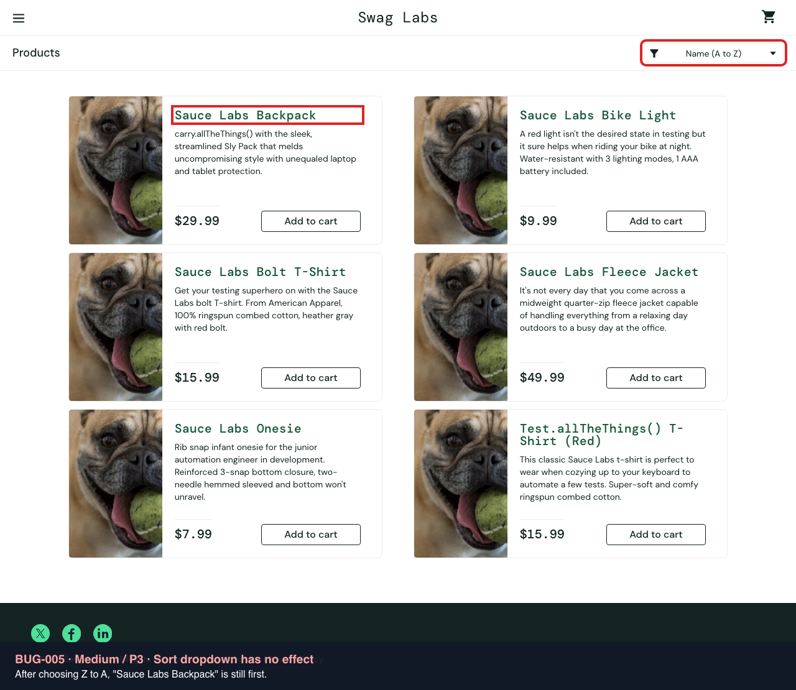
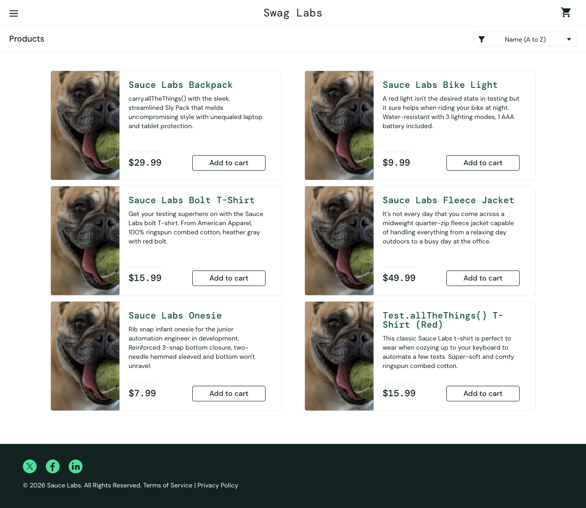

# BUG-005 — Product sort dropdown has no effect

| Field | Value |
|---|---|
| Severity | **Medium** |
| Priority | **P3 – backlog** |
| Component | Inventory › Sort |
| Labels | inventory, sort, usability |
| Environment | https://www.saucedemo.com · Chromium 159 (Playwright 1.65.1, Desktop Chrome 1280×720) · macOS 26.2 |
| Account | `problem_user` / `secret_sauce` (control: `standard_user` behaves correctly) |
| Reported | 2026-11-16 · Anne Mary Wynter |
| Status | Open |

## Summary
Choosing **Name (Z to A)** in the sort dropdown leaves the product list in A→Z order. The dropdown label also stays on *Name (A to Z)*.

## Steps to reproduce
1. Log in as `problem_user`.
2. Open the sort dropdown on Products and choose **Name (Z to A)**.

## Expected
List starts with *Test.allTheThings() T-Shirt (Red)* and ends with *Sauce Labs Backpack*.

## Actual
List order is unchanged (*Sauce Labs Backpack* first).

## Impact
Shoppers cannot sort, but every product is still visible and reachable. Medium severity, P3.

## Evidence
Annotated screenshot (red outline = the defect):

Screenshot captured by the automated test:

- Full-page screenshot after choosing Z to A: [inventory-after-sort-za.png](evidence/BUG-005/inventory-after-sort-za.png)
- Video: [video.webm](evidence/BUG-005/video.webm) · Trace: [trace.zip](evidence/BUG-005/trace.zip)
- Assertion output: [assertion-failures.txt](evidence/BUG-005/assertion-failures.txt)

## Automated test
`tests/problem-user/known-defects.spec.ts` › *BUG-005 sort Name (Z to A) reverses the list* (`@BUG-005 @sev-medium @P3`)
