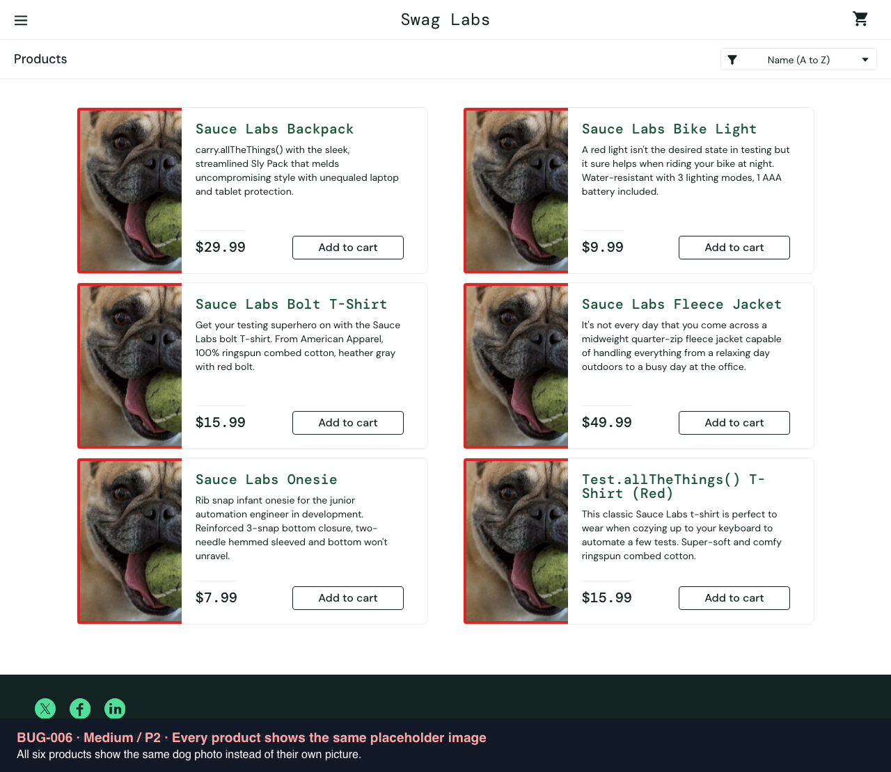
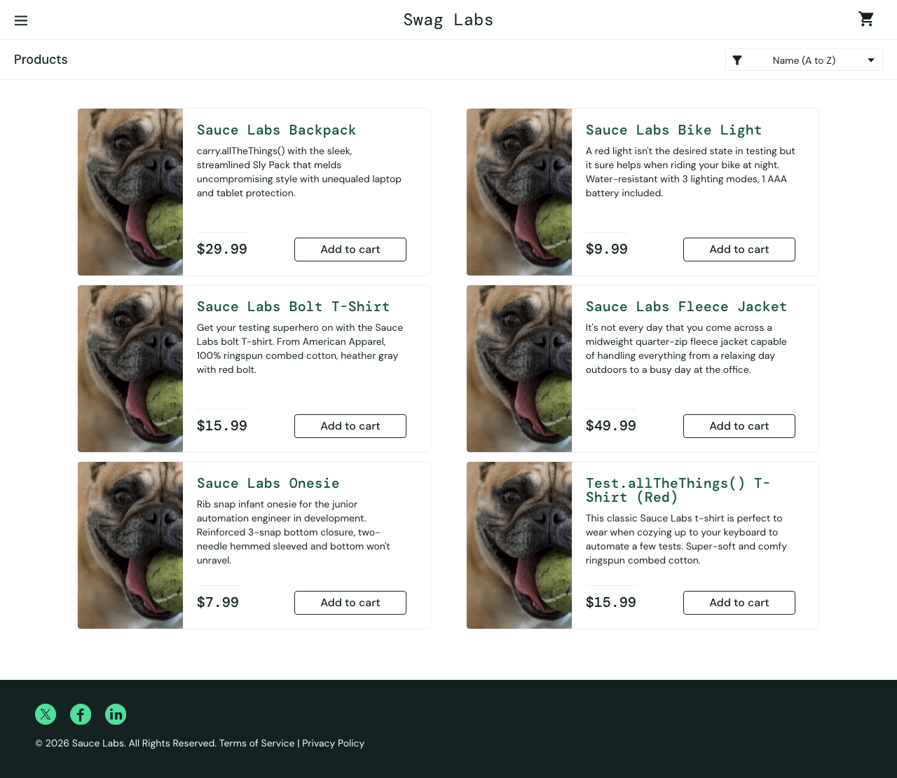

# BUG-006 — Every product shows the same placeholder image instead of its own photo

| Field | Value |
|---|---|
| Severity | **Medium** |
| Priority | **P2 – next sprint** |
| Component | Inventory › Product images |
| Labels | ui, images, content |
| Environment | https://www.saucedemo.com · Chromium 159 (Playwright 1.65.1, Desktop Chrome 1280×720) · macOS 26.2 |
| Account | `problem_user` / `secret_sauce` (control: `standard_user` behaves correctly) |
| Reported | 2026-11-16 · Anne Mary Wynter |
| Status | Open |

## Summary
On the Products page all six products show the same dog photo. Every image's `src` is the 404 placeholder `/assets/sl-404-Cq1a9k9X.jpg`; `standard_user` gets six distinct product images.

## Steps to reproduce
1. Log in as `problem_user`.
2. Look at the product images on the Products page (or inspect the `` `src` values).

## Expected
Six distinct product images (backpack, bike light, t-shirt, etc.).

## Actual
Six copies of the same placeholder image; one unique `src` instead of six.

## Impact
Users cannot tell products apart visually. Function is unaffected (Medium severity), but it is highly visible on the main landing page and hurts conversion, so priority is raised to P2.

## Evidence
Annotated screenshot (red outline = the defect):

Screenshot captured by the automated test:

- Full-page screenshot: [inventory-images.png](evidence/BUG-006/inventory-images.png)
- Image `src` values: [image-src-values.json](evidence/BUG-006/image-src-values.json)
- Video: [video.webm](evidence/BUG-006/video.webm) · Trace: [trace.zip](evidence/BUG-006/trace.zip)
- Assertion output: [assertion-failures.txt](evidence/BUG-006/assertion-failures.txt) — `Expected: 6`, `Received: 1`

## Automated test
`tests/problem-user/known-defects.spec.ts` › *BUG-006 every product shows its own image* (`@BUG-006 @sev-medium @P2`)
