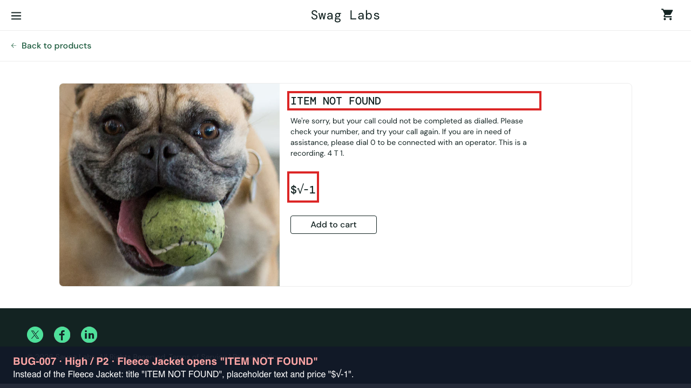
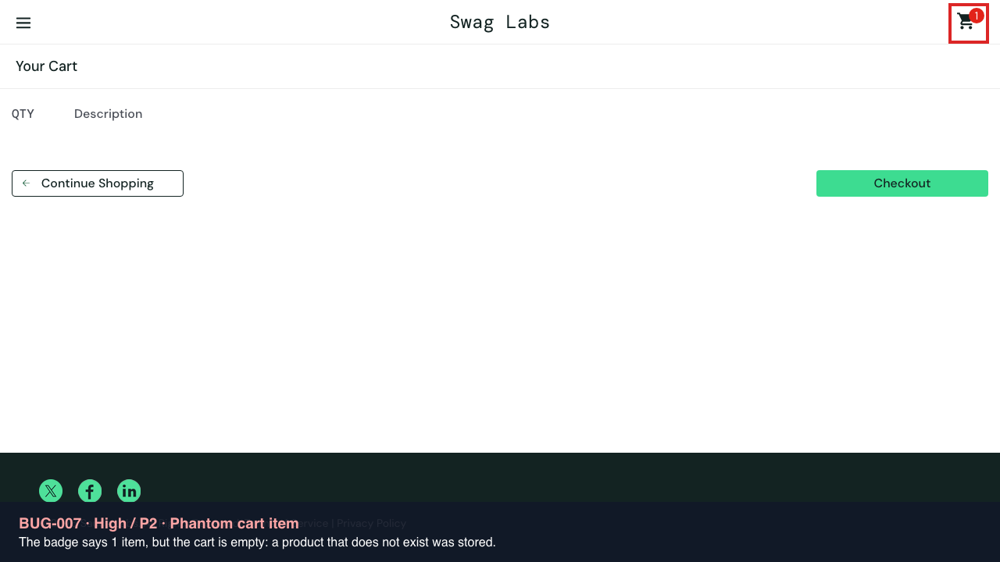
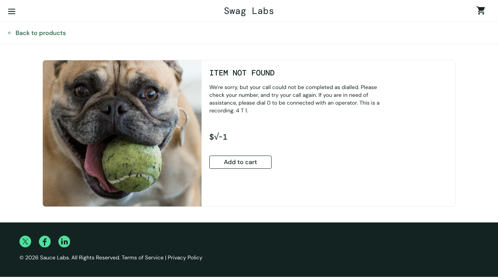
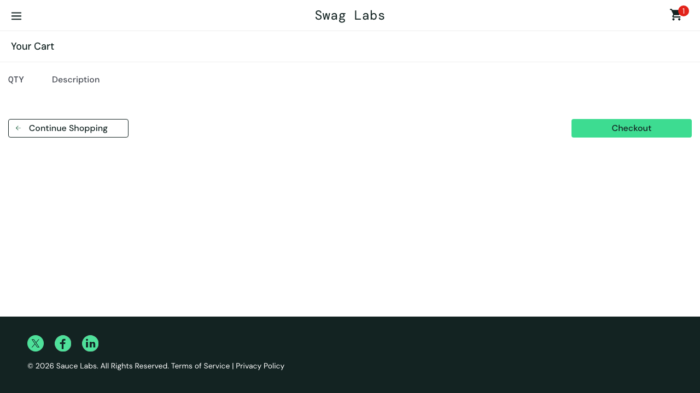

# BUG-007 — Fleece Jacket opens an "ITEM NOT FOUND" page; Add to cart there creates a phantom cart item

| Field | Value |
|---|---|
| Severity | **High** |
| Priority | **P2 – next sprint** |
| Component | Product detail page |
| Labels | product-detail, cart, data-integrity |
| Related | BUG-004 (same root cause: product links point one id too high) · BUG-002 |
| Environment | https://www.saucedemo.com · Chromium 159 (Playwright 1.65.1, Desktop Chrome 1280×720) · macOS 26.2 |
| Account | `problem_user` / `secret_sauce` (control: `standard_user` behaves correctly) |
| Reported | 2026-11-16 · Anne Mary Wynter |
| Status | Open |

## Summary
Opening **Sauce Labs Fleece Jacket** from the Products page shows a product page titled **ITEM NOT FOUND**, with placeholder text (*"We're sorry, but your call could not be completed as dialled…"*), the dog placeholder image and the price **$√-1**. The page still has an **Add to cart** button. Clicking it sets the cart badge to **1**, but the cart page is empty: a non-existent item (id 6) is stored in the cart.

## Steps to reproduce
1. Log in as `problem_user`.
2. On Products, click the name **Sauce Labs Fleece Jacket**.
3. Look at the product page.
4. Click **Add to cart**.
5. Click the cart icon.

## Expected
Step 3: URL `/inventory-item.html?id=5`, title *Sauce Labs Fleece Jacket*, price $49.99.
Step 5: the cart lists *Sauce Labs Fleece Jacket*.

## Actual
Step 3: URL `/inventory-item.html?id=6`, title *ITEM NOT FOUND*, price *$√-1*.
Step 4: cart badge shows 1.
Step 5: cart is empty, although the badge still shows 1. Browser storage `cart-contents` = `[6]`.

## Impact
The highest-priced product cannot be viewed. Together with BUG-002 (it cannot be added from the Products page either), the Fleece Jacket cannot be bought at all. The phantom item makes the cart count wrong, which erodes trust and could break checkout totals.

## Evidence
Annotated screenshots (red outline = the defect):

Screenshot captured by the automated test:

- Product page: [product-page-after-clicking-fleece-jacket.png](evidence/BUG-007/product-page-after-clicking-fleece-jacket.png)
- Cart after Add to cart: [cart-after-adding-from-that-page.png](evidence/BUG-007/cart-after-adding-from-that-page.png)
- Video: [video.webm](evidence/BUG-007/video.webm) · Trace: [trace.zip](evidence/BUG-007/trace.zip)
- Assertion output: [assertion-failures.txt](evidence/BUG-007/assertion-failures.txt)

## Automated test
`tests/problem-user/known-defects.spec.ts` › *BUG-007 Fleece Jacket opens its own product page and adds a real item* (`@BUG-007 @sev-high @P2`)
